<p align="center">
  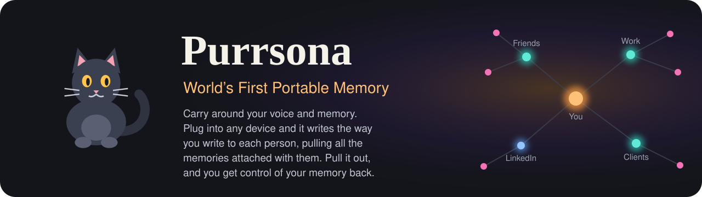
</p>

<p align="center">
  
  
  
  
  
</p>

<p align="center">
  <!-- TODO(Sunday): real links -->
  <a href="https://purrsona-production.up.railway.app"><b>Live demo</b></a> · <b>Demo video</b> (link on submission day) · <a href="#try-it">Run it locally</a> · <b>Blog</b> (link on submission day)
</p>

<p align="center">
  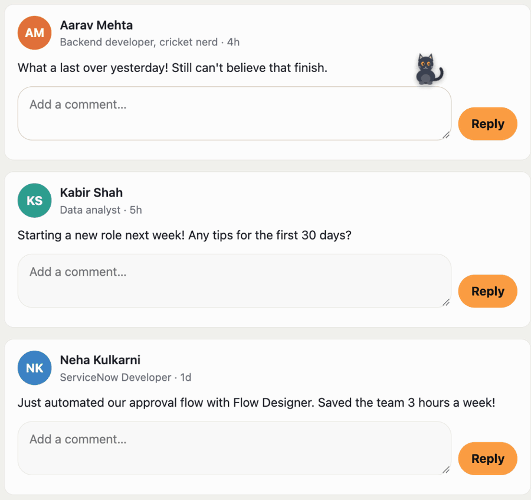
</p>

## The problem

You don't write to your manager the way you write to your college friend, and neither of them gets what a client gets. AI writing tools give everyone one voice. So you paste the message into a chatbot, again and again, and ask "can you make it sound like me?" It never tells you why a draft sounds the way it does. And whatever it learns about you lives on someone else's server.

Purrsona keeps your voice in a graph: who you write to, which circle they're in, which platform you're on, what you're talking about, and the rules that make each reply sound like you, each one linked to the edits that taught it. The graph lives on a key you carry. Plug it into any laptop and the cat writes like you. Pull it out and that laptop forgets you.

## Purrsona in 30 seconds

1. **Plug in your key and press its button.** That press is your consent. The key hands the laptop your voice, and the laptop builds your graph in FalkorDB.
2. **Press the right Option key + M in any reply box** (the Option key next to M; Alt+M on Windows). A small cat sits on the box. The graph picks the rules for this person, this platform and this topic, and Claude writes the words.
3. **Edit it and send.** The Learner compares what it wrote with what you sent and saves the difference as a rule, on the graph and on the key.
4. **Pull the key out.** The laptop deletes your graph (`GRAPH.DELETE`). The next draft is generic. Plug the key into another laptop, and your voice is back, with everything it learned.

<p align="center">
  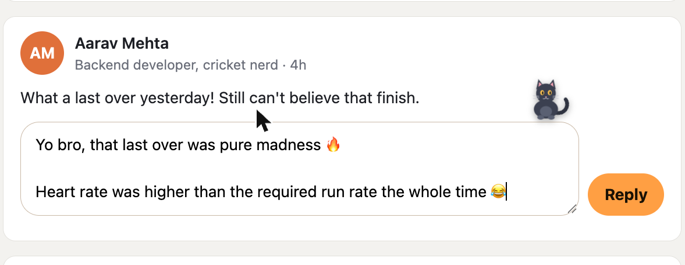
  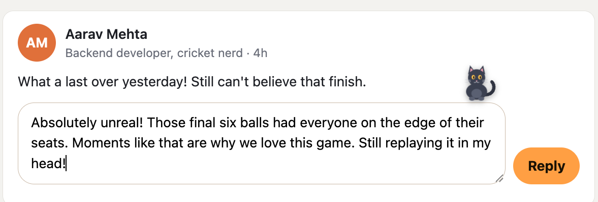
  <br><sub>Same post, same shortcut. Left: the key is plugged in, so Aarav, a friend, gets "Yo bro… 🔥". Right: the key is out, the graph is gone, and the reply is generic.</sub>
</p>

## FalkorDB is the heart

Take FalkorDB out and Purrsona is a chatbot with a cat. Every part of it is a graph question:

| Question | How the graph answers |
|---|---|
| Who is this person to me? | person → circle → relationship ("my new manager" is part of Work) |
| Which rules apply right now? | rules from five scopes (the person, their circle, the topic, the platform, you) in one pattern; the narrowest one wins |
| Someone new? | no person node yet, so they inherit their circle's, the platform's and the topic's rules |
| Why does this draft sound like that? | walk back from the draft to each rule, its owner, and the edits that taught it |
| A new habit clashes with an old rule? | the new, narrower rule `OVERRIDES` the old one; the old one is kept as history |
| What's my signature style? | PageRank over the links from drafts to the rules they used |
| Forget me | each key has its own graph; delete it, and the memory is gone from this laptop |

### The voice graph

<p align="center">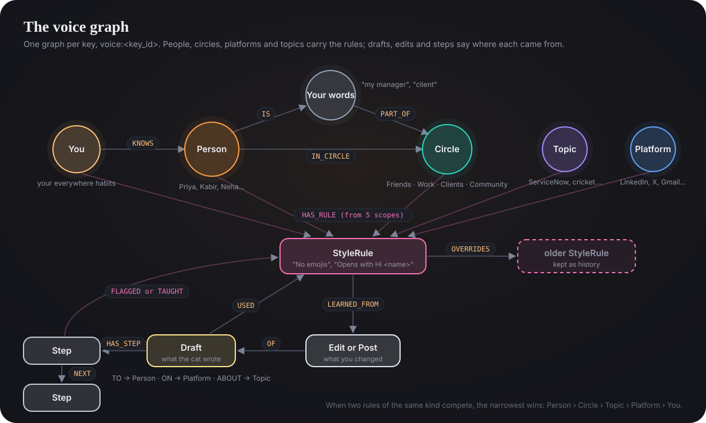</p>

When two rules of the same kind compete, the narrowest scope wins: Person → Circle → Topic → Platform → You. Phrase rules stack instead. A retired rule keeps its history but is never applied. Every label and property: [`docs/GRAPH-MODEL.md`](docs/GRAPH-MODEL.md).

The agents read it only through fixed, parameterised Cypher (`ro_query` for reads): the main queries are under [The Cypher it depends on](#under-the-hood), and the one behind every "why?" is in [Every draft explains itself](#every-draft-explains-itself).

<table>
  <tr>
    <td width="50%">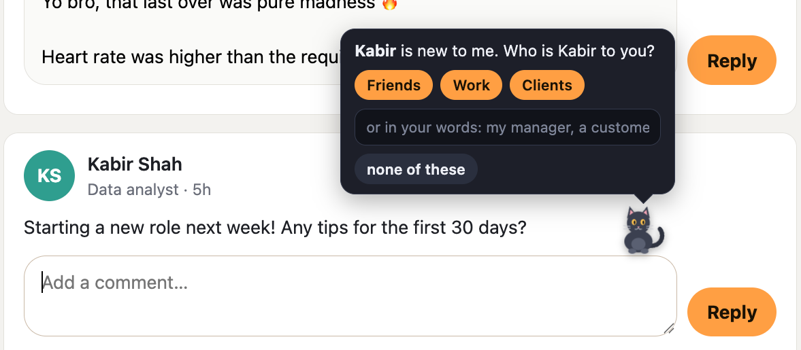<br><sub><b>Someone new.</b> Kabir isn't in the graph, so the cat says so and asks once. A circle, or your own words like "my new manager", decides which rules he inherits.</sub></td>
    <td width="50%">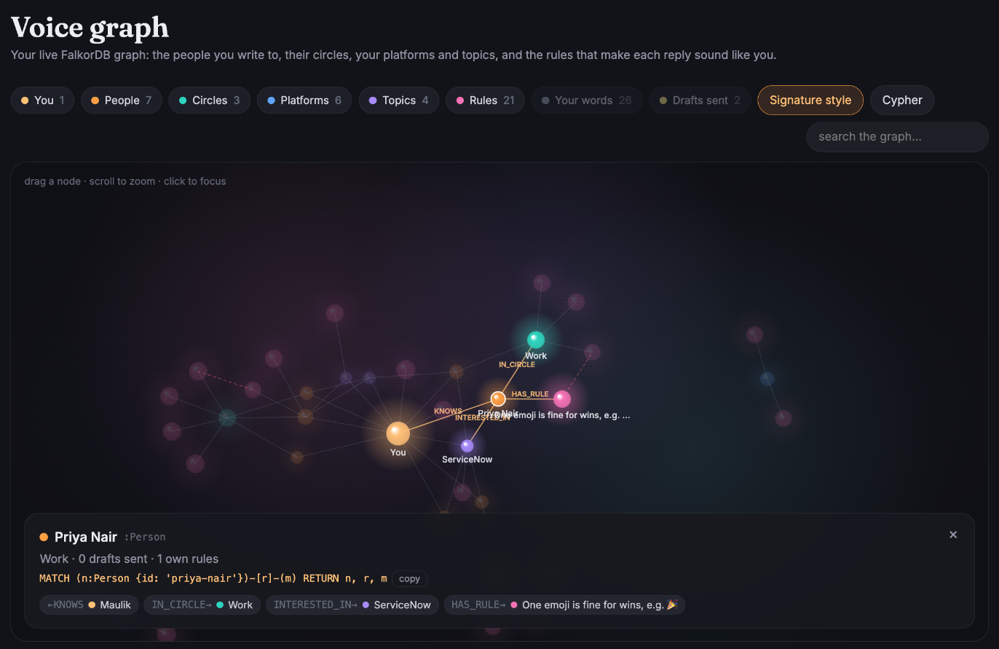<br><sub><b>Your live voice graph</b>, straight from FalkorDB: click Priya to see her circle, her topic, her own rule and the Cypher that fetches them.</sub></td>
  </tr>
</table>

## Three agents, one graph

Purrsona has three agents, and they never call each other. The bridge hands each one its input, and every step it takes lands in the graph as a `Step` node, linked to the rule it broke or learned. The Learner runs later, when you press send, and picks up only from what the graph recorded. The graph is their shared memory, and every handoff is a node you can query.

- **The Drafter** writes a reply, your own post, or a polished version of your rough note, from the rules the graph picked.
- **The Critic** checks the draft against those same rules in code: emoji limit, sentence limit, length, greeting, sign-off, banned phrases, hashtags. It takes milliseconds and no AI call. If the draft broke a rule, the Critic sends it back once, with the reason: "broke 'one to three sentences' (it has 4)".
- **The Learner** runs when you press send. It compares the draft with what you sent, plus anything you asked the cat to change, and saves up to three rules, each linked to the edit that taught it. Even an unchanged send is a memory: who you wrote to, where, and with which rules.

<p align="center">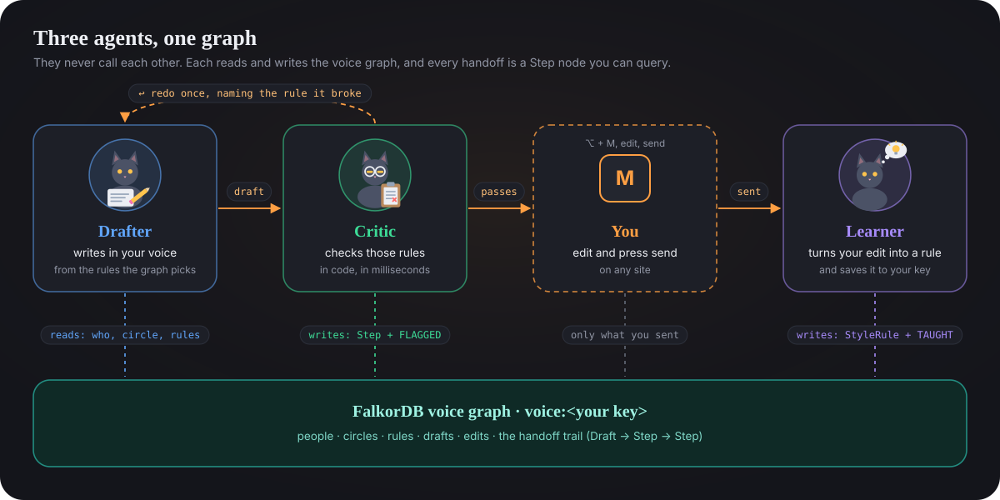</p>

<p align="center">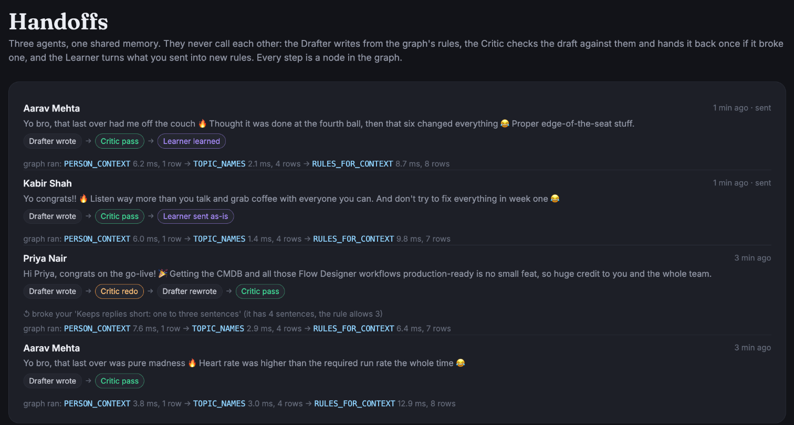</p>
<p align="center"><sub>Every draft's steps are <code>Step</code> nodes in the graph: Drafter wrote → Critic redo → Drafter rewrote → Critic pass → Learner learned.</sub></p>

## Your voice, portable

A writing style is personal data. Purrsona keeps it on something you hold.

**The key** is a LilyGO T-Display-S3: an ESP32-S3 with a 1.9-inch screen and two buttons, on USB-C. Mustafa built its firmware. It stores only two things: a snapshot of your voice graph and an append-only log of everything it has learned since. All the work happens on the laptop; the key holds the memory, asks for consent and shows what's happening.

- **Consent is a button press.** Nothing loads until you press it.
- **Memory travels with you.** Plug the key into any laptop running the bridge: it sends the snapshot and the memory log, and the bridge rebuilds your graph and replays every memory in order.
- **Every send is written back** to the key as one more line in its log, the moment you send.
- **Forgetting is physical.** Pull the key out and the bridge deletes your graph from that laptop. Press its eject button first, and the screen confirms "Forgotten" before you unplug.

| Moment | Laptop to key | What happens |
|---|---|---|
| Plug in | `HELLO` → `UNLOCK` (button) → `PULL` | the key sends the snapshot and the memory log; the bridge builds `voice:<key_id>` and replays it |
| Learn | `APPEND` | one new memory on the key; it replies with the new count |
| Unplug | `BYE`, or the cable is pulled | `GRAPH.DELETE voice:<key_id>`; the laptop forgets |

**Status, honestly:** physical pairing, graph display, saving a memory, deleting the laptop graph on unplug, and restoring the memory after reconnecting have passed on the T-Display-S3 with **mocked AI**. The virtual key remains available for demos without hardware. See [physical key setup and remaining checks](firmware/README.md) and [key video evidence](video/README.md). <!-- TODO(Sunday): photo of the T-Display-S3 -->

## One database, many voices

Every key gets its own graph, `voice:<key_id>`, on one FalkorDB instance. A user is a graph, not a filter someone can forget to apply: a query in one person's graph can't see another's. Forgetting one person is one `GRAPH.DELETE`, and nobody else is touched.

**The load test** ([`scripts/load_test.py`](scripts/load_test.py), Oct 18, a MacBook Air with FalkorDB v4.22 in Docker): 1,000 made-up users, each plugged in as their own graph on one FalkorDB, then 5,000 draft lookups for random users, 32 at a time.

| Step | p50 | p95 | p99 |
|---|---|---|---|
| Plug in: build a user's graph from their snapshot | 10.6 ms | 13.9 ms | 15.9 ms |
| Draft lookup: who the person is, the topics, which rules win (3 queries) | 20.4 ms | 41.3 ms | 57.0 ms |
| Unplug: `GRAPH.DELETE` | 0.6 ms | 2.1 ms | 4.2 ms |

- **1,424 draft lookups a second.** Claude takes seconds to write a draft; the graph's part is milliseconds.
- **Isolation:** every user had one rule nobody else had. All 1,000 saw only their own, and none of the 5,000 lookups running at once saw anyone else's.
- **Forgetting:** after unplugging everyone, no graph was left. Each user's graph took about 2 MB of memory.
- Plug-in here is the snapshot alone. A key also replays what it has learned: about 0.1 s for the demo key's 23 memories.

Run it on a database you can throw away (it never touches `voice:demo-maulik`):

```bash
docker run -d --rm --name purrsona-load-db -p 6390:6379 falkordb/falkordb:v4.22.0
FALKORDB_PORT=6390 uv run --project api python scripts/load_test.py --users 1000 --workers 32 --lookups 5000
```

## Every draft explains itself

Click the cat and ask **why?** You get the rules behind the draft, who owns each one, how many edits taught it and when, the agents' handoffs, and every query the graph ran, with its time and row count. Nothing is reconstructed after the fact: it's what the graph returned while the draft was being written.

<p align="center">
  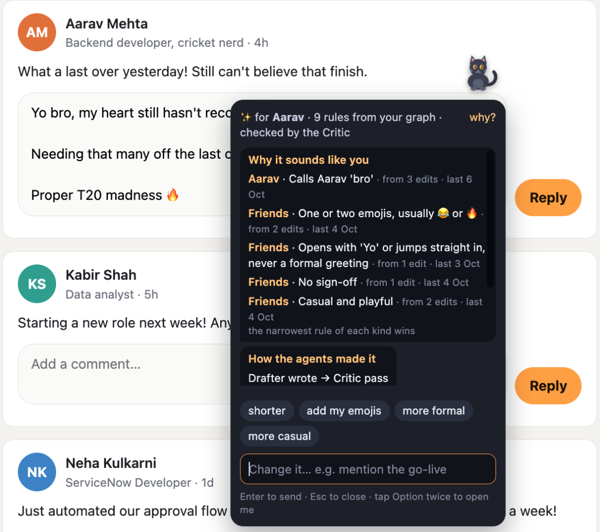
  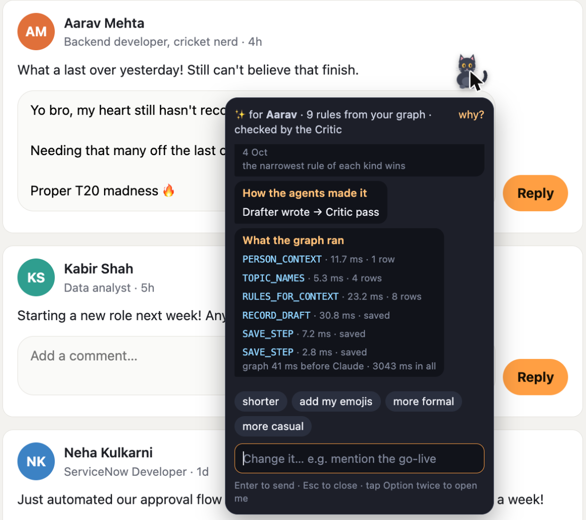
</p>

The core of it is a short query, written step by step in FalkorDB Browser:

```cypher
MATCH (d:Draft {id: $draft})-[:USED]->(r:StyleRule)<-[:HAS_RULE]-(s)
OPTIONAL MATCH (r)-[:LEARNED_FROM]->(ev)
RETURN r.text AS rule, labels(s)[0] AS scope, coalesce(s.name, s.id) AS owner, count(ev) AS evidence
ORDER BY CASE scope WHEN 'Person' THEN 1 WHEN 'Circle' THEN 2 WHEN 'Topic' THEN 3 WHEN 'Platform' THEN 4
                    WHEN 'User' THEN 5 ELSE 6 END, evidence DESC
```

`OPTIONAL MATCH` keeps a rule that nothing has taught yet, and `count(ev)` then says 0 instead of 1.

## Track 02 checklist

| The track asks for | In Purrsona |
|---|---|
| Memory across sessions | the key's append-only memory log, replayed into the graph at every plug-in |
| Episodic memory | `Draft`, `Edit` and `Step` nodes: what was written, what you changed, which agent did what, and when |
| Semantic memory | `StyleRule` nodes with a scope and their evidence (`LEARNED_FROM`); newer, narrower rules `OVERRIDES` older ones |
| Handoffs between agents | Drafter → Critic → Learner; every handoff is a `Step` node (`FLAGGED`, `TAUGHT`), and the Learner picks up later from what the graph recorded |
| Separate memory per user, many at once | one graph per key on one FalkorDB instance; forgetting is one `GRAPH.DELETE`; load-tested with 1,000 users and 32 lookups at a time, no leaks |
| Decisions traced back to the graph | every draft keeps the rules it `USED`; the why shows owners, evidence, dates, the trail and the queries |

## Where it works, and what it reads

The hackathon asks for data that is "public, synthetic, or your own". Purrsona has two modes so it never reads a private conversation:

| Where | What the cat does | What it reads |
|---|---|---|
| **Public posts:** LinkedIn, X, Reddit | Option+M drafts a reply in your voice | only the post you're replying to, at the moment you press the key |
| **Private apps:** Slack, Teams, Gmail | you type a rough message; Option+M rewrites it in your voice | only what you typed. Who it's for comes from the message box's own name ("Message Neha Kulkarni") when that names one person you know; in a channel or group it asks |

LinkedIn and X direct messages are left out on purpose: the cat doesn't appear there. It reads nothing in the background, and it never presses send for you. Claude gets one small brief per draft: the post or your note, plus the handful of rules the graph chose, never the whole graph. The people in the demo and on the practice page are made up.

| | Status |
|---|---|
| Practice page (no install needed) | works |
| LinkedIn: comments, replies, new posts, company pages | tested on the real site |
| X: replies and new posts | tested on the real site |
| Gmail, Slack | tested on the real site |
| Reddit: comments and replies | tested on the real site |
| Teams | not tested yet |

## Try it

**Live demo: https://purrsona-production.up.railway.app**. You get your own key and your own graph, and nobody else can see them. Start an empty key that learns how you write, or try the demo key (Maulik's voice with made-up people) to see everything at once. Draft on the practice page with nothing to install (click a reply box, press **right Option + M**), or point the extension at it: right-click the toolbar cat → **Options** → **The online demo**. Each visitor has an hourly limit on drafts, and a key nobody uses for 3 hours is forgotten. The hardware key is in the video.

**Run it locally** (about 10 minutes). You need Docker Desktop, [uv](https://docs.astral.sh/uv/getting-started/installation/), Chrome, and your own Anthropic API key (a draft costs about 1–2 cents).

```bash
git clone https://github.com/Maulik176/purrsona.git
cd purrsona
docker compose up -d                 # FalkorDB on localhost:6380, FalkorDB Browser on http://localhost:3001
cp .env.example .env                 # put your key after ANTHROPIC_API_KEY=
cd api && uv sync
uv run uvicorn purrsona.app:app --port 8765 --reload
```

Then open:
1. **http://localhost:8765/practice/**: a made-up feed with the cat already running. Click a reply box, press **right Option + M** (the Option key right of the space bar, next to M; Alt+M on Windows and Linux), click the cat for "shorter" or "why?", edit and press Reply, then unplug the key from the header and try again.
2. **http://localhost:8765/dashboard/**: your live voice graph, your writing rules (forget any of them), what the key has learned, and the agents' handoffs.
3. **The Chrome extension**: `chrome://extensions` → Developer mode → Load unpacked → the `extension/` folder (or unzip [the release](https://github.com/Maulik176/purrsona/releases/latest) and pick that folder). Open LinkedIn or X, click a comment box, press **right Option + M**. The cat icon in Chrome's toolbar (or "dashboard ↗" in the cat's chat) opens your dashboard.
4. **http://localhost:3001**: FalkorDB Browser, with the graph `voice:demo-maulik` while the key is plugged in.

### Use the LilyGO T-Display-S3

The firmware and USB bridge are implemented. Follow the
[physical key setup](firmware/README.md) to flash the board, pair its fingerprint,
and start the API with `PURRSONA_USB=1`. The display includes an ASCII brain
animation and a graph navigated with its two buttons. Physical pairing, graph
display, saving a memory, laptop cleanup on unplug, and restoring that memory
after reconnecting have passed on the T-Display-S3 with mocked AI.

After flashing and pairing, `bun run hardware-demo` runs the physical key with
a temporary real FalkorDB and fixed mock AI replies, without Docker or an AI key.
Press B to unlock, then open **http://127.0.0.1:8765/practice/**. Run only one bridge
process at a time. The USB-enabled API setup in the firmware guide uses real AI replies.

To try the complete flow without a board or AI key, run `bun run simulator` and
open **http://127.0.0.1:8876/sim/**. Connect, approve with B, browse the graph,
and use the practice page to save a memory. The simulator runs the C++ firmware
with mock hardware and AI, plus an isolated real FalkorDB. See the
[simulator walkthrough](firmware/README.md#try-the-complete-demo-without-hardware).

Run `bun run allcheck --force` from the repo root to compile firmware and run all
tests against a temporary, isolated FalkorDB. The
[protocol contract](docs/PROTOCOL.md) describes the messages shared by the board,
USB client and simulator.

The console, dashboard and practice page subscribe to `/key/events` for live
connection, approval, drafting, saving and forgetting states. Each reconnect gets
the current state; the stream contains counts and status, never draft or memory
text. Personal graph views clear immediately on disconnect, and “Forgotten” only
appears after graph deletion succeeds. If running Uvicorn directly, add
`--timeout-graceful-shutdown 2` so open event streams cannot delay stopping it.

## Under the hood

<details>
<summary><b>Architecture</b></summary>

<p align="center">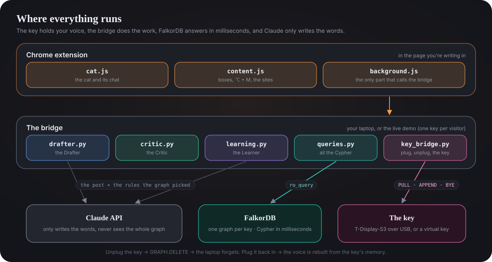</p>

The extension only reads the box you're in and the post you're replying to, and only the service worker talks to the bridge. The bridge is the only part that talks to the key, to FalkorDB and to Claude.
</details>

<details>
<summary><b>The Cypher it depends on</b></summary>

Every query lives in [`api/purrsona/queries.py`](api/purrsona/queries.py), is fixed in the code and takes parameters, and the core ones have tests against a seeded graph. Reads go through FalkorDB's read-only `ro_query`. Claude never writes or sees a query.

**Which rules apply** (five scopes in one pattern; the narrowest wins):

```cypher
OPTIONAL MATCH (p:Person {id: $person})
OPTIONAL MATCH (p)-[:IN_CIRCLE]->(c:Circle)
OPTIONAL MATCH (hint:Circle {name: $circle_hint})
OPTIONAL MATCH (pl:Platform {name: $platform})
OPTIONAL MATCH (t:Topic) WHERE t.name IN $topics
OPTIONAL MATCH (u:User)
WITH collect(DISTINCT p) + collect(DISTINCT c) + collect(DISTINCT hint)
     + collect(DISTINCT t) + collect(DISTINCT pl) + collect(DISTINCT u) AS scopes
UNWIND scopes AS s
WITH DISTINCT s
MATCH (s)-[:HAS_RULE]->(r:StyleRule)
WHERE r.superseded_at IS NULL AND coalesce(r.applies_to, 'any') IN ['any', $mode]
OPTIONAL MATCH (r)-[:LEARNED_FROM]->(ev)
WITH s, r, count(ev) AS evidence, max(ev.at) AS last_seen
OPTIONAL MATCH (r)-[:OVERRIDES]->(old:StyleRule)
WITH s, r, evidence, last_seen, collect(old.text) AS replaces,
     CASE labels(s)[0] WHEN 'Person' THEN 1 WHEN 'Circle' THEN 2 WHEN 'Topic' THEN 3
                       WHEN 'Platform' THEN 4 ELSE 5 END AS rank
ORDER BY rank, evidence DESC
WITH r.kind AS kind,
     collect({id: r.id, text: r.text, scope: labels(s)[0], scope_name: coalesce(s.name, s.id),
              rank: rank, evidence: evidence, last_seen: last_seen, replaces: replaces}) AS candidates
RETURN kind, CASE WHEN kind IN $stacking THEN candidates ELSE candidates[0..1] END AS chosen
```

**Remember a rule and the edit that taught it**, then let it outrank the broader rule without deleting it:

```cypher
MATCH (p:Person {id: $person_id}), (e:Edit {id: $edit_id})
CREATE (p)-[:HAS_RULE]->(r:StyleRule {id: $rule_id, kind: $kind, text: $text, created_at: $at})-[:LEARNED_FROM]->(e)

MATCH (r:StyleRule {id: $rule_id})
UNWIND $old_ids AS oid
MATCH (old:StyleRule {id: oid})
CREATE (r)-[:OVERRIDES]->(old)
```

**Your signature style** (a FalkorDB algorithm, so the ranking comes from the graph's shape):

```cypher
CALL algo.pageRank(null, 'USED') YIELD node, score
WITH node, score WHERE node:StyleRule AND node.superseded_at IS NULL
RETURN node.id AS id, node.text AS text, score
ORDER BY score DESC LIMIT $limit
```

| Query | What it answers or does |
|---|---|
| `PERSON_CONTEXT` | who this person is to me, and how often I've written to them |
| `RULES_FOR_CONTEXT` | which rules apply (above) |
| `TOPIC_NAMES` | topics and their keywords, matched as whole words |
| `RELATIONSHIP_WORDS`, `SAVE_RELATIONSHIP`, `LINK_RELATIONSHIP` | your own words for people ("manager" → Work); a new word is sorted once, then the graph knows it |
| `RECORD_DRAFT` | a draft, the rules it used, its person, platform and topics |
| `WHY_THIS_DRAFT` | the why (above) |
| `SAVE_PERSON`, `SAVE_EDIT`, `SAVE_SENT`, `LINK_USED` | what you sent, and to whom |
| `SAVE_LEARNED_RULE`, `LINK_OVERRIDES`, `SUPERSEDE` | a learned rule, its evidence, and what it outranks |
| `SAVE_STEP`, `STEP_FLAGGED`, `STEP_TAUGHT`, `TRAIL_STEPS` | the agents' handoffs (`MERGE`, so a replayed memory never doubles them) |
| `SIGNATURE_STYLE` | PageRank over `USED` |
| `GRAPH_NODES`, `GRAPH_LINKS`, `ALL_RULES`, `PEOPLE_STATS`, `DRAFT_HISTORY`, `RECENT_TRAILS` | the dashboard |
</details>

<details>
<summary><b>Numbers</b></summary>

Measured on a MacBook Air with FalkorDB v4.22 in Docker, Oct 17:

| | |
|---|---|
| Graph lookups before Claude writes (person, topics, rules) | about 20–70 ms |
| Plug in, the seed alone | 25–65 ms |
| Plug in with 9 memories replayed one by one | 0.4–0.9 s |
| A whole draft, Claude included | about 2.5–3 s |
| The Learner, after you send | about 3–4 s, in the background |
</details>

<details>
<summary><b>Project map</b></summary>

| Path | What |
|---|---|
| `api/purrsona/queries.py` | every Cypher query, and the tracer behind "what the graph ran" |
| `api/purrsona/keys.py` | the virtual key: plug in, replay the memory log, unplug |
| `api/purrsona/drafter.py`, `critic.py`, `critic_checks.py`, `learning.py` | the three agents |
| `api/purrsona/relationships.py` | your own words for people → circles |
| `api/purrsona/app.py` | the bridge API (`/docs` lists every endpoint) |
| `extension/` | `content.js` (boxes, Option+M, site adapters, learning on send), `cat.js` (the cat and its chat), `background.js` |
| `api/purrsona/static/` | the practice page, the dashboard and the step-by-step console |
| `data/seed/demo-maulik.json` | the demo voice: made-up people, circles, platforms, topics, rules and the edits behind them |
| `docs/` | the graph model, key authentication notes |
</details>

## How we built it

We started from the questions, not the data. Before writing code we wrote down the ten things the agent must answer ("who is this person to me?", "why does this draft sound like that?", "what happens when an edit clashes with a rule?") and modelled the graph from them. These are the decisions that shaped it:

- **One graph per key, not one big graph with a user column.** Isolation comes for free, and forgetting someone is one `GRAPH.DELETE` that can't touch anyone else.
- **The key is the source of truth; the laptop graph is a cache.** Memory is an append-only log on the key, replayed at every plug-in. So a laptop can always throw its copy away.
- **Rules hang off five scopes, and the narrowest wins.** Someone you've never written to still gets a sensible first draft from their circle, the platform and the topic.
- **Invalidate, don't delete.** A rule that's outranked or replaced keeps its history (`OVERRIDES`, `superseded_at`), so every draft can still be explained later.
- **Agents coordinate through the graph, not through each other.** Each handoff is a node, so the whole process is queryable, and replaying a memory is safe.
- **The graph picks what the model sees.** Claude gets a small brief, never the graph. Every query is fixed in the code and parameterised; the model never writes Cypher.
- **Check in code before calling a model.** The Critic measures rules in milliseconds and allows at most one redo, so a draft is never stuck in a loop.
- **Read only at the key press, and never a private conversation.** That's why there are two modes.
- **The key only stores and consents.** All the work runs on the laptop, so the hardware stays simple and drafts stay fast.
- **A virtual key with the same calls**, so the product works and can be judged without hardware.

| Layer | Choice | Why |
|---|---|---|
| Memory | FalkorDB v4.22 in Docker | graph-per-tenant, in-memory traversals, Cypher, built-in PageRank |
| Bridge | Python 3.12, FastAPI | one small process between the extension, the key, FalkorDB and Claude |
| Writing | Claude (Anthropic API) | writes drafts, learns rules from edits, sorts new relationship words |
| Extension | Chrome Manifest V3, plain JavaScript, shadow DOM | works on LinkedIn, X, Reddit, Slack, Teams and Gmail without touching their pages' styles |
| Dashboard | plain JavaScript and d3 | the live graph, rules, memories and handoffs |
| Key | LilyGO T-Display-S3 (ESP32-S3), USB-C | consent button, status screen, the memory log |

**How we worked.** The way many teams build now: the two of us owned the design, the architecture and every decision above, and AI coding assistants (Claude Code and OpenAI Codex) did most of the implementation from our specs. Nothing went in unchecked. We reviewed what the assistants wrote, every change had to pass the automated tests written alongside it (188 today), and we tested the flows by hand on the real sites and on the physical board.

- **Maulik Ranadive** (Ahmedabad): the product, the graph model, the agents and their handoffs, the queries' design, the extension's flows and the privacy rules. Wrote the "why" query, the Critic's checks and the platform rules himself, and tested the flows by hand on LinkedIn, X, Reddit, Slack and Gmail.
- **Mustafa Africawala** (UK): the hardware key: the board, the signed USB protocol and its consent flow, the firmware, the bridge's USB side and the simulator. Tested it on the physical T-Display-S3: pairing, signed unlock, saving a memory, forgetting on unplug, restoring on reconnect.

We can walk you through any line of it.

## Honest limits

- The hardware key passed pairing, signed unlock, saving, forgetting on unplug and restoring on reconnect with **mocked AI**. A power cut in the middle of a write and an unplug on battery are still unchecked.
- The key's USB messages and its flash are plaintext. We left flash encryption off on purpose so the board stays reusable; the virtual key (a snapshot file plus a memory log) is unencrypted too.
- The Critic measures what code can measure. It doesn't judge tone, and its checks are simple patterns: a skin-toned emoji counts as two, and "e.g." splits a sentence.
- Site layouts change. The adapters use the most stable hooks we found, but a redesign can break one.
- Replaying memories is done one query at a time, so plug-in slows down as the key learns more. Batching it is next.
- It learns from replies and messages you send, not yet from your own new posts.
- PageRank is the only graph algorithm in use so far.

## What's next

- The hardware key: a hash chain over its memory log, flash encryption, and an eject button that shows "Forgotten" on its screen before you pull it out.
- Batched replay, so plug-in stays fast however much the key has learned.
- Community detection, so the graph also picks example replies from people you write to the same way.

## Credits

The cat's meow is "Cat Meow 8" by sound_garage on Pixabay, used under the Pixabay Content License.

## License

[MIT](LICENSE)
