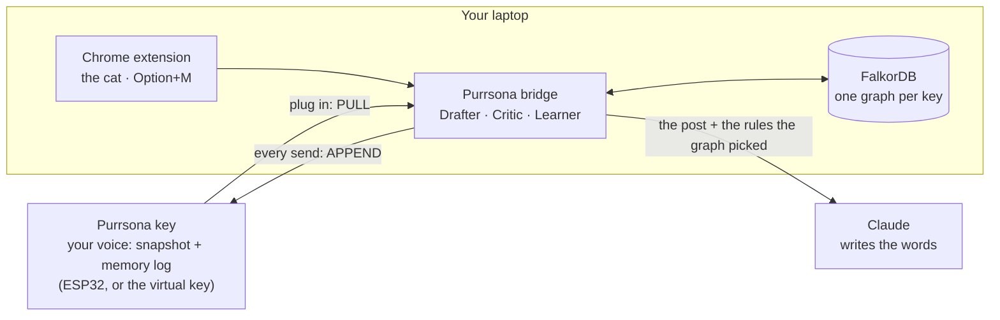
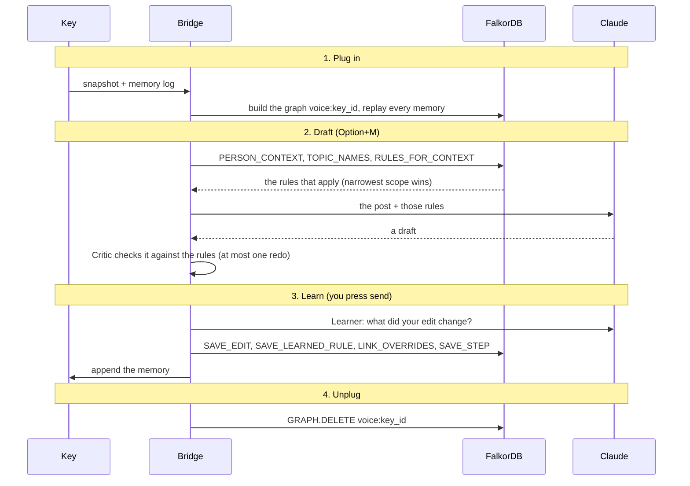
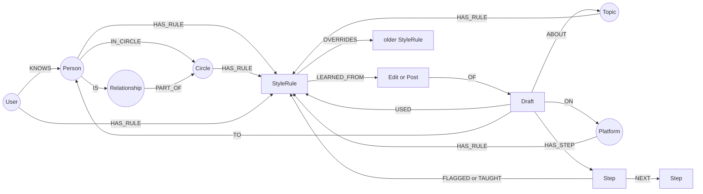

# 🐱 Purrsona

**Purrsona carries your voice on a key: plug in anywhere; unplug, and the AI forgets.**

Purrsona maps how you write to each person, platform and topic, and shows which edits taught it.

**Graph Hacks: Context for AI Agents** (WeMakeDevs × FalkorDB) · **Track 02: Agent Memory and Coordination**

<!-- Links filled in on submission day -->
**Demo video:** _link added on submission day_ · **Live demo:** _link added on submission day_ · **Try it locally in 10 minutes:** [Run it locally](#run-it-locally)

---

## In one minute

You're on LinkedIn. Priya, your manager, posts that the go-live finally happened. You click the comment box, a small cat sits on its edge, you press **Option+M**, and a reply lands in the box *the way you write to Priya*: "Hi Nair", no emoji, one paragraph. That isn't how you write to your college friend Aarav ("Yo", 🔥, no sign-off), and it isn't how you write to a client.

Purrsona knows the difference because your voice is a **FalkorDB graph**: people → circles → style rules, plus platforms and topics, and every rule points to the edits that taught it. Edit a draft and send it, and the **Learner** turns what you changed into a new rule. Ask the cat **why?** and it shows the rules, who owns each one, how many edits taught it and when, the agents' handoffs, and every query the graph ran.

The graph lives on a **memory key** you plug in. Unplug it and the bridge runs `GRAPH.DELETE`: the next draft is generic. Plug it back in and everything it learned comes back.

| | Key plugged in | Key unplugged |
|---|---|---|
| Reply to Priya's go-live post | "Hi Nair, congratulations to you and the whole team on the go-live. Getting the CMDB clean and the Flow Designer workflows production-ready is no small feat…" | a generic, polite congratulations |
| Why it sounds that way | 7 rules: Priya's own (surname greeting, no emoji, one paragraph) beat Work's; ServiceNow terms from the topic | nothing: no graph, no voice |

## Why it needs a graph

**Take FalkorDB out and Purrsona is just a chatbot with a cat.** Every part of the product is a graph question:

| The question | Why it's a graph question | Query |
|---|---|---|
| Who is this person to me? | person → circle → relationship ("my manager" is part of Work) | `PERSON_CONTEXT` |
| Which rules apply right now? | gather rules from five scopes (person, circle, topic, platform, you) in one pattern; the narrowest scope wins | `RULES_FOR_CONTEXT` |
| Someone new? | no Person node, so they inherit their circle's, the platform's and the topic's rules | `RULES_FOR_CONTEXT` with `circle_hint` |
| Why does this draft sound like that? | walk back from the draft to each rule, its owner and the edits that taught it | `WHY_THIS_DRAFT` |
| An edit clashes with a rule? | a narrower rule `OVERRIDES` a broader one; the old one is kept, never deleted | `LINK_OVERRIDES`, `SUPERSEDE` |
| What's my signature style? | PageRank over the drafts → rules they used | `SIGNATURE_STYLE` (`algo.pageRank`) |
| Forget me | one graph per key: delete the graph and the memory is gone from the laptop | `GRAPH.DELETE voice:<key_id>` |

## Track 02 checklist

| The track asks for | How Purrsona does it | Where |
|---|---|---|
| **Memory across sessions** | every send is a memory on the key (an append-only event log); plugging in builds the graph from the key's snapshot and replays every memory | [`keys.py`](api/purrsona/keys.py), `apply_event` in [`learning.py`](api/purrsona/learning.py) |
| **Episodic memory** (what happened) | `Draft`, `Edit` and `Step` nodes: what was written, what you changed, which agent did what, with timestamps | `SAVE_EDIT`, `SAVE_SENT`, `SAVE_STEP` |
| **Semantic memory** (what it means) | `StyleRule` nodes with a scope, a kind and provenance (`LEARNED_FROM`); a newer, narrower rule `OVERRIDES` an older one, which is kept as history | `SAVE_LEARNED_RULE`, `LINK_OVERRIDES` |
| **Handoffs between agents** | Drafter → Critic → (one redo) → Critic → Learner. The agents never call each other: each reads and writes the graph, and every handoff is a `Step` node you can query (`FLAGGED` the rule it broke, `TAUGHT` the rule it learned) | `SAVE_STEP`, `STEP_FLAGGED`, `STEP_TAUGHT`, `TRAIL_STEPS` |
| **Separate memory per user** | one graph per key (`voice:<key_id>`) on one FalkorDB instance: a user is a graph, not a filter someone can forget | [`db.py`](api/purrsona/db.py) |
| **Decisions traced back to the graph** | every draft keeps the rules it `USED`; the why shows each rule's owner, evidence and date, the agents' trail, and each query the graph ran (name, milliseconds, rows) | `WHY_THIS_DRAFT`, `queries.Traced` |

## How it works



The key holds your voice, the laptop does the work, Claude only writes the words, and the graph decides what Claude sees.



**The three agents**
- **Drafter** ([`drafter.py`](api/purrsona/drafter.py)): writes a reply, your own post, or a polished version of your rough note, from the rules the graph picked.
- **Critic** ([`critic.py`](api/purrsona/critic.py)): checks the draft against those same rules in code (emoji limit, sentence limit, length, greeting, sign-off, banned phrases, hashtags; milliseconds, no AI call). If the draft broke one, it sends it back once with the reason ("broke Work's 'No emojis'"), and the redo is a step in the graph.
- **Learner** ([`learning.py`](api/purrsona/learning.py)): when you send, compares the draft with what you actually sent (and anything you asked the cat to change) and saves up to three rules, each linked to the edit that taught it. A send with no changes still becomes a memory: who you wrote to, on which platform, with which rules.

## The graph model



**Rule precedence:** when rules of the same kind compete, the narrowest scope wins: Person → Circle → Topic → Platform → You. Phrase rules (`phrase_use`, `phrase_avoid`) stack. A superseded rule keeps its history but is never applied. Every label, property and relationship: [`docs/GRAPH-MODEL.md`](docs/GRAPH-MODEL.md).

## The Cypher it depends on

Every query lives in [`api/purrsona/queries.py`](api/purrsona/queries.py), is written by a person, takes parameters, and has a test against a seeded graph ("something found" and "nothing found"). Reads use FalkorDB's read-only `ro_query`. **Claude never writes or sees a query.**

**Which rules apply** (the heart of it: five scopes in one pattern, the narrowest wins):

```cypher
OPTIONAL MATCH (p:Person {id: $person})
OPTIONAL MATCH (p)-[:IN_CIRCLE]->(c:Circle)
OPTIONAL MATCH (hint:Circle {name: $circle_hint})
OPTIONAL MATCH (pl:Platform {name: $platform})
OPTIONAL MATCH (t:Topic) WHERE t.name IN $topics
OPTIONAL MATCH (u:User)
WITH collect(DISTINCT p) + collect(DISTINCT c) + collect(DISTINCT hint)
     + collect(DISTINCT t) + collect(DISTINCT pl) + collect(DISTINCT u) AS scopes
UNWIND scopes AS s
WITH DISTINCT s
MATCH (s)-[:HAS_RULE]->(r:StyleRule)
WHERE r.superseded_at IS NULL AND coalesce(r.applies_to, 'any') IN ['any', $mode]
OPTIONAL MATCH (r)-[:LEARNED_FROM]->(ev)
WITH s, r, count(ev) AS evidence, max(ev.at) AS last_seen
OPTIONAL MATCH (r)-[:OVERRIDES]->(old:StyleRule)
WITH s, r, evidence, last_seen, collect(old.text) AS replaces,
     CASE labels(s)[0] WHEN 'Person' THEN 1 WHEN 'Circle' THEN 2 WHEN 'Topic' THEN 3
                       WHEN 'Platform' THEN 4 ELSE 5 END AS rank
ORDER BY rank, evidence DESC
WITH r.kind AS kind,
     collect({id: r.id, text: r.text, scope: labels(s)[0], scope_name: coalesce(s.name, s.id),
              rank: rank, evidence: evidence, last_seen: last_seen, replaces: replaces}) AS candidates
RETURN kind, CASE WHEN kind IN $stacking THEN candidates ELSE candidates[0..1] END AS chosen
```

`OPTIONAL MATCH` is what makes someone new work: there's no Person node for them, so a plain `MATCH` would return nothing, but here their circle, the platform, the topic and your own habits still apply.

**Why this draft sounds like that** (Q6, written by Maulik):

```cypher
MATCH (d:Draft {id: $draft})-[:USED]->(r:StyleRule)<-[:HAS_RULE]-(s)
OPTIONAL MATCH (r)-[:LEARNED_FROM]->(ev)
RETURN r.text AS rule, labels(s)[0] AS scope, coalesce(s.name, s.id) AS owner, count(ev) AS evidence
ORDER BY CASE scope WHEN 'Person' THEN 1 WHEN 'Circle' THEN 2 WHEN 'Topic' THEN 3 WHEN 'Platform' THEN 4
                    WHEN 'User' THEN 5 ELSE 6 END, evidence DESC
```

**Remember a rule and the edit that taught it**, then let it outrank the broader rule without deleting it:

```cypher
MATCH (p:Person {id: $person_id}), (e:Edit {id: $edit_id})
CREATE (p)-[:HAS_RULE]->(r:StyleRule {id: $rule_id, kind: $kind, text: $text, created_at: $at})-[:LEARNED_FROM]->(e)

MATCH (r:StyleRule {id: $rule_id})
UNWIND $old_ids AS oid
MATCH (old:StyleRule {id: oid})
CREATE (r)-[:OVERRIDES]->(old)
```

**Your signature style** (a FalkorDB algorithm: the ranking comes from the graph's shape, not a counter):

```cypher
CALL algo.pageRank(null, 'USED') YIELD node, score
WITH node, score WHERE node:StyleRule AND node.superseded_at IS NULL
RETURN node.id AS id, node.text AS text, score
ORDER BY score DESC LIMIT $limit
```

**Forget:** `GRAPH.DELETE voice:<key_id>` when the key is unplugged.

<details>
<summary>All queries and what each one answers</summary>

| Query | Answers / does |
|---|---|
| `PERSON_CONTEXT` | who this person is to me: circle, my word for them, how often I've written to them and when |
| `RULES_FOR_CONTEXT` | which rules apply to this person, platform, topic and mode (above) |
| `TOPIC_NAMES` | the topics and their keywords (whole-word match: "bhaila" isn't "AI") |
| `RELATIONSHIP_WORDS`, `SAVE_RELATIONSHIP`, `LINK_RELATIONSHIP` | your own words for people ("manager" → Work); a new word is sorted once and saved, so next time the graph answers |
| `RECORD_DRAFT` | a draft and the rules it used (`USED`), its person, platform and topics |
| `WHY_THIS_DRAFT` | Q6, above |
| `SAVE_PERSON` | someone new joins the graph, in a circle only if that circle exists (`OPTIONAL MATCH` + `FOREACH`) |
| `SAVE_EDIT`, `SAVE_SENT` | what you sent: an edit of the draft, or the draft as it was |
| `DRAFT_RULES`, `LINK_USED` | the rules behind a draft, saved with the memory so the links come back after a re-plug |
| `SAVE_LEARNED_RULE`, `LINK_OVERRIDES`, `SUPERSEDE` | a learned rule, its evidence, and what it outranks or replaces |
| `SAVE_STEP`, `STEP_FLAGGED`, `STEP_TAUGHT`, `TRAIL_STEPS` | the agents' handoff trail (idempotent `MERGE`, so a replayed memory never duplicates it) |
| `SIGNATURE_STYLE` | PageRank over `USED` (above) |
| `GRAPH_NODES`, `GRAPH_LINKS`, `ALL_RULES`, `PEOPLE_STATS`, `DRAFT_HISTORY`, `RECENT_TRAILS`, `COUNTS`, `PEOPLE`, `GRAPH_SUMMARY` | the dashboard: the live graph map, every rule with owner and evidence, people, the "it learns" chart, the handoffs |

</details>

## Design principles

- **The graph picks what Claude sees.** Claude gets one small brief per draft: the post you're replying to (or your own note) and the handful of rules the graph chose. Never the whole graph, never a private conversation.
- **People write the queries; the agents pick them.** No generated Cypher, every value is a parameter, reads are read-only.
- **Check the model against the graph.** The Critic measures Claude's draft against the same rules the graph handed it, in code, before you see it.
- **Say what isn't in the graph.** Someone new: "Kabir is new to me. Who is Kabir to you?" Key unplugged: "No key plugged in, so this is a generic draft." A company page: no circle question, only the platform's and your own rules.
- **Invalidate, don't delete.** A rule that's outranked or replaced keeps its history (`OVERRIDES`, `superseded_at`); forgetting a rule from the dashboard is itself a memory on the key.
- **Show the path with the answer.** The why lists the rules, their owners, their evidence and dates, the agents' handoffs and every query the graph ran, with timings:

```
PERSON_CONTEXT · 4.1 ms · 1 row
TOPIC_NAMES · 2.2 ms · 4 rows
RULES_FOR_CONTEXT · 10 ms · 7 rows
graph 17 ms before Claude · 2.5 s in all
```

## Privacy and the hackathon's data rule

The rules ask for data that is "public, synthetic, or your own" and nothing private. Purrsona is built around that, with **two modes**:

| Where | What the cat does | What it reads |
|---|---|---|
| **Public posts:** LinkedIn, X, Reddit | Option+M drafts a reply in your voice | only the public post you're replying to, at the moment you press the key |
| **Private apps:** Slack web, Teams web, Gmail, LinkedIn and X messages | you type a rough message, Option+M rewrites it in your voice | **only what you typed.** It never reads the conversation. Who it's for comes from the message box's own name ("Message Neha Kulkarni") when that names one person you already write to; in a channel or group, or for someone new, it asks |

- **Nothing is read in the background.** The cat reads a page only when you press Option+M, click it, or press send.
- **It never posts for you.** It fills the box; you press send.
- **Your memory lives on your key.** Unplugging deletes your graph from the laptop. The demo key's memory log is a local file that is never committed.
- **Demo data is made up or our own:** the people in `data/seed/` and on the practice page are invented; the video uses the practice page and our own accounts, with made-up test chats.

### Where it works today

| Where | Mode | Status |
|---|---|---|
| Practice page (`/practice/`), no install needed | both | tested |
| LinkedIn: comments, replies under a comment, new posts, company posts | reply | tested on the real site |
| X: replies and new posts | reply | tested on the real site (draft, edit, learn on send) |
| Gmail | your words | tested on the real site |
| Slack web | your words | tested on the real site; re-test of the latest insert fix pending |
| Reddit | reply | built from Reddit's page structure; real-site test pending |
| Teams web | your words | not tested (needs a Teams web sign-in) |
| The hardware key (ESP32) | | in progress; the virtual key stands in, behind the same calls |

## Numbers

Measured on a MacBook Air with FalkorDB v4.22 in Docker:

| | |
|---|---|
| Graph lookups before Claude writes (person, topics, rules) | **17 ms** (Oct 17) |
| Plug in: build the graph from the snapshot and replay the memories | **30–50 ms** (Oct 15) |
| A whole draft, Claude included | about **2.5 s** |
| The Learner, after you send | about **3–4 s**, in the background |
| Automated tests | **44**, every Cypher query against a seeded graph |

## Run it locally

You need **Docker Desktop**, **[uv](https://docs.astral.sh/uv/getting-started/installation/)** (it installs Python 3.12 for you), **Chrome**, and **your own Anthropic API key** (each draft costs about 1–2 cents).

```bash
git clone https://github.com/Maulik176/purrsona.git
cd purrsona
docker compose up -d                 # FalkorDB on localhost:6380 (graph browser on http://localhost:3001)
cp .env.example .env                 # then put your key after ANTHROPIC_API_KEY= (.env is gitignored)
cd api
uv sync
uv run uvicorn purrsona.app:app --port 8765 --reload
```

Then try it in this order:
1. **Practice page**, http://localhost:8765/practice/: a made-up feed, with the cat already running (no install). Click a reply box and press **Option+M** (Alt+M on Windows/Linux). Kabir is new: the cat asks who he is to you. Click the cat for **shorter**, **why?** and more. Edit the draft and press Reply: the cat learns. Unplug the key from the header and draft again: generic. Plug it back in: it remembers.
2. **Dashboard**, http://localhost:8765/dashboard/: your live voice graph from FalkorDB (drag it, search it, click any person or rule), your writing rules (forget any with ✕), what the key learned, the agents' handoffs with the queries behind them, and your signature style (PageRank).
3. **Console**, http://localhost:8765/: the step-by-step demo: plug in → pick a person → draft → the why as five scope lanes → teach it an edit → unplug → plug back in.
4. **Chrome extension**: `chrome://extensions` → Developer mode → **Load unpacked** → the `extension/` folder. Open LinkedIn or X, click a comment box, press Option+M. After changing extension code, press ↻ on its card and refresh the page.
5. **FalkorDB Browser**, http://localhost:3001: the graph `voice:demo-maulik` while the key is plugged in.
6. **Tests**: `cd api && uv run pytest`. They plug and unplug the same demo graph: plug the key in again afterwards, and don't run them during a demo.

The bridge forgets the plugged key when it restarts: plug in again from the practice page header or the console.

## Where things are

| Path | What |
|---|---|
| [`api/purrsona/queries.py`](api/purrsona/queries.py) | every Cypher query, and `Traced` (the query list behind each draft) |
| [`api/purrsona/keys.py`](api/purrsona/keys.py) | the virtual key: plug in = build the graph from the snapshot and replay the memory log; unplug = `GRAPH.DELETE`. The hardware key replaces this behind the same calls ([`CONTRIBUTING.md`](CONTRIBUTING.md#3-plugging-in-the-real-key-what-the-bridge-needs)) |
| [`api/purrsona/drafter.py`](api/purrsona/drafter.py), [`critic.py`](api/purrsona/critic.py), [`critic_checks.py`](api/purrsona/critic_checks.py), [`learning.py`](api/purrsona/learning.py) | the three agents |
| [`api/purrsona/relationships.py`](api/purrsona/relationships.py) | your own words for people → circles |
| [`api/purrsona/app.py`](api/purrsona/app.py) | the bridge API (`/docs` lists every endpoint) |
| [`extension/`](extension/) | `content.js` (boxes, Option+M, site adapters, learning on send), `cat.js` (the cat and its chat), `background.js` (the only part that calls the bridge) |
| [`api/purrsona/static/`](api/purrsona/static/) | the practice page, the dashboard and the console |
| [`data/seed/demo-maulik.json`](data/seed/demo-maulik.json) | the demo voice: made-up people, circles, platforms, topics, rules and the edits behind them |
| [`docs/`](docs/) | the graph model, key authentication notes, the manual test plan |

## How we built it

**Team**
- **Maulik Ranadive** (Ahmedabad): the product and every decision behind it, the graph model, the extension's UX, the demo voice, testing on the real sites, the blog and the video.
- **Mustafa Africawala** (UK): the hardware key (ESP32 with a display: the USB protocol, authentication, storage and status screen), and a review of the agents.

**AI assistance (disclosed, as the rules ask).** We built Purrsona with **Claude Code** (Anthropic, Claude Opus 5.5) as a pair programmer, and the product uses the **Claude API** (Opus 5.5) to write drafts, sort new relationship words and learn from your edits. Commits written with Claude Code end with a `Co-Authored-By: Claude` line; commits without it were written by hand, e.g. `a4b7318`, the Critic's three checks. The team designed the product, made the calls below, reviewed the code, and can explain every query.

**What Maulik designed, wrote and decided**
- The graph model: rules hang off five scopes so someone new still gets a sensible first draft; every rule points to the edits that taught it (`LEARNED_FROM`); a person's rule `OVERRIDES` the circle's instead of deleting it.
- **Q6, `WHY_THIS_DRAFT`**: built step by step in FalkorDB Browser (including why `OPTIONAL MATCH` and `count(ev)` keep a rule nothing taught).
- The learned-rule save as three small queries, one idea each: someone I know → what I changed → the rule and where it came from.
- **The Critic's checks** in [`critic_checks.py`](api/purrsona/critic_checks.py) (emoji count, sentence count, banned phrases), by hand, and fixed the two real-world cases a review found.
- The calls that shaped the product: unplug = forget as the main moment; two modes so private chats are never read; every send leaves a memory, even unchanged; a quiet cat that only explains when you ask; companies and "none of these" still remembered; your own words for people ("my new manager"); no tone check and at most one redo in the Critic.
- A 67-case manual test plan run on the real sites; most of the fixes in this repo started as a failed case there.

## Known limits

- **The hardware key is in progress.** The virtual key (a snapshot file plus an append-only memory log) runs the same plug, learn and unplug calls; its log isn't encrypted yet.
- **The Critic doesn't judge tone**, only what code can measure. Its checks are simple patterns: a skin-toned 👍🏽 counts as two emojis, some symbols (⭐, flags) aren't counted, and "e.g." splits a sentence.
- **Site layouts change.** The adapters use the most stable hooks we found (roles, labels, test ids), but a redesign can break one. Reddit isn't tested on the real site yet; Teams isn't tested.
- **One graph algorithm so far** (PageRank). Community detection (people you write to the same way) is next.
- **Learning comes from what you send** as replies and messages; your own new posts aren't learned from yet.
- **One key at a time** per bridge.

## What's next

- The hardware key: a button press to unlock, the memory log on the key with a hash chain, and "Forgotten" on its screen when you pull it out.
- Community detection, so the graph also picks two example replies for Claude from the people you write to the same way.
- A hosted bridge where every visitor gets their own virtual key and graph.
- An MCP server, so other agents can write in your voice from the same graph.

## License

[MIT](LICENSE)
